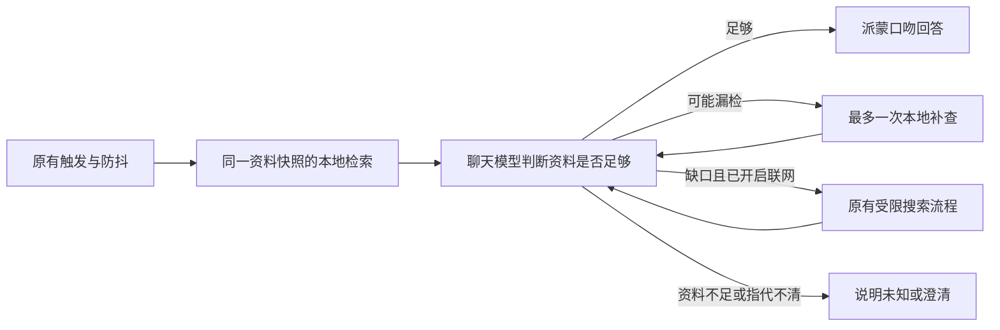

# 《日月全事》本地知识库首版

2026-10-25：已完成代码、资料导入和离线验证，默认关闭。源码位于本插件，未推送、部署、重启或调用真实 API/QQ。本页命令均在插件根目录执行。

## 已完成的步骤

| 步骤 | 结果 |
| --- | --- |
| 资料整理与解析 | 明确收录九份 Markdown，按标题、段落、表格行建立 1,297 个片段；保留文件、原始行号、章节和脚注 |
| 本地召回 | 中文分词与二元字组 BM25、标题加权、别名扩展、同节邻接段落；不依赖向量服务或新数据库 |
| 聊天接入 | 回答前检索，必要时最多一次本地补查；联网关闭仍可使用，直接回答通常只需原聊天一次 API |
| 资料边界 | 正文放独立 user 数据块；区分整理内容、编者评论及不确定表述，程序映射合法出处 |
| 持续更新 | 可重复构建、内容哈希修订号、原子切换、旧版本回滚、同次回答固定快照及缓存按修订隔离 |
| 验证 | 100 道人工编写的检索回归题，96 道达到预期；完整插件离线测试 355/355 通过 |

## 启用

先构建并检查索引：

```sh
node scripts/knowledge.js build
node scripts/knowledge.js status
node scripts/knowledge.js query "博士原名叫什么？"
```

在个人 `config/config.yaml` 的已有分组中合并：

```yaml
knowledge:
  enabled: true
  provider: genshin-lore
  topK: 6
  maxContextChars: 10000
  includeSources: false
```

旧配置若写了 `provider: none`，也必须修改，否则仍不启用。默认配置继续关闭，未修改用户个人配置。首次安装 JS 需要重启 Yunzai；安装后开关、预算和出处设置支持热更新。知识库更新用构建命令完成，无需再次重启。服务器需在自己的插件目录构建：索引位于被 Git 忽略的 `data/knowledge/`，不会随代码推送。

`webSearch.enabled` 与本地检索独立。不需要联网、长期记忆或近期会话持久化才能回答本地剧情问题。近期会话功能启用时，检索可利用它提供的同作者候选和引用；关闭时仍可利用当前活跃 session 的用户历史。

`topK` 范围 2～8，默认 6 个主片段，另最多 2 个同节邻接段落。`maxContextChars` 范围 2,000～16,000，默认 10,000，包括标题与脚注的正文字符；JSON 元数据、聊天历史、网页预算另算，不等同 token 数。补查新证据优先，同一修订的旧证据在剩余预算内保留；超出预算整块舍弃，避免把半段脚注当完整依据。

## 资料与依据

2026-10-28：源目录由插件根目录的 `genshinlore-md/` 迁至 `knowledge/genshinlore-md/`，与角色资料统一管理。九份 Markdown 及下载清单原样迁移；构建器默认读取新目录，命令不变。快照内仍以相同的源文件名和内容标识定位，既有索引不需要仅因目录迁移而重建。更新源资料后仍需执行构建，生成物继续位于 `data/knowledge/`。

`knowledge/sources.json` 明确列出 Teyvathis、Mondstadt、Liyue、Inazuma、Sumeru、Fontaine、Natlan、Snezhnaya、Khaenriah 九份文件。PDF、修改说明、备份及目录中的其他 Markdown 不会被自动收录。本次以现有同步后的 Markdown 为输入，没有重新修改书中原文。

`markdown.js` 保留标题路径，长段按句子切分并合并相邻小段，表格转为带列名的逐行内容。脚注归回引用片段，缺失脚注/表格列数不一致使导入失败。脚注中的 `p` 页码只定位脚注，不能当作整段已验证的 PDF 页码；回复出处使用文件及原始行号。

所有正文默认 `compilation`，编者之声、结语及明确编者的话为 `compiler_commentary`，并标记检测到的疑似/推测/传说等表述。这是保守分类，不是逐句官方事实审核。引用来源并不能自动证明整理者的结论；模型仍须阅读原文条件与上下文，不得把引用里的“我”当派蒙经历。

`knowledge/aliases.json` 用于检索名称扩展，不能作为人物同一性、神格/人偶关系或时代归属的证明。最长名称优先，单字“影”不会匹配“影响”；通用称号需要剧情语境。局部规则只支持明确列出的关系（目前包括雷电影的姐姐），没有建立完整知识图谱。

每个片段有稳定 `kb-…` ID。模型返回 `sourceIds` 后，程序只接受本轮实际提供的来源。默认不附出处，用户追问出处或 `includeSources: true` 时附最多两条选中出处；若模型未选择合法 ID，不凭空补来源。网页仍用原有 `w…` ID。程序校验的是 ID 存在，不能代替对“证据是否支持结论”的人工/模型核验。

## 检索和聊天流程



最多三次模型请求，无中间动作消息。本地检索不用模型、不收费；必要补查后再生成会增加模型请求和上下文 token。编者资料不自动写入用户长期记忆，网页也不自动覆盖正式资料。

本地 provider 命中返回 `partial/unknown`，未命中返回 `miss`；相似度不等于完整覆盖，导入日期不等于核实日期，书籍版次不等于当前游戏版本。足以回答时模型应直接回答，不能把每个 partial 都当作联网理由。真正索引错误或 1.5 秒查询超时返回 error，沿用现有“服务异常不自动触发网页”边界。

中文词法召回不能完全覆盖语义改写，模型可用具体人物/事件重写一次查询。不明确的指代不借用群里其他人的最近话题；检索不读取用户长期记忆来扩展公开知识查询。攻略关键词、常见闲聊及明显低匹配问题做保守过滤，但不声称已实现完美领域分类。

关闭知识库、插件、变更有效 provider/Key、移出白名单或 dispose，会取消相关在途流程，并在发送前复查。已发出的请求或消息无法撤回。预算参数按批次快照，修改后对后续批次生效。

日志 `knowledge_lookup` 记录修订、状态、原因、候选 ID 和截断标记，`knowledge_used` 记录模型选中的合法来源 ID 及被拒绝的来源数量；补查次数和模型轮次沿用 `search_summary`。这些元数据事件不另存问题/资料正文，模型请求和响应正文仍遵循原有日志开关。选中 ID 只代表模型引用了它，不等于已验证回答正确。

## 更新与回滚

1. 人工核对新版 PDF/修改说明，把新增、修订及删除合并到相应 Markdown；新书版次写入 `knowledge/sources.json`。不要把未知的游戏版本填成已核实。
2. 运行 `node scripts/knowledge.js build --no-activate`，先生成候选快照。
3. 运行 `node scripts/evaluate-knowledge.js`：直接读取当前 Markdown/元数据，评测候选内容，不改活动指针。详细结果写入 `data/knowledge/evaluation.json`。
4. 通过检查后运行 `node scripts/knowledge.js build` 激活同一候选。文件未变化时 revision 不变，不产生重复快照。
5. 需要撤回时运行 `node scripts/knowledge.js rollback`；指定保留版本用 `node scripts/knowledge.js rollback <revision>`，也可用此命令切换到已构建的候选。`status` 显示实际加载版本和异常标记。

快照记录原文件哈希、字节数、片段数、解析器版本及内容校验；`active.json` 原子替换，构建失败保留旧活动版本。写入用 `update.lock` 排他锁，避免并发构建/回滚。进程异常退出留下锁时，确认没有构建/回滚进程后才手动移除锁，不自动抢锁。

运行进程第一次加载用 Worker 构建内存倒排索引，避免中文分词长时间阻塞聊天主线程；随后查询使用有界 128 项内存缓存。每次新回答检查活动指针，同一次回答与补查固定在同一 revision；新 revision 创建新的检索缓存，原网页缓存和会话证据的 revision 检查使旧分区不再复用。不同机器各自构建，不自动同步索引。

若新快照校验失败，优先保留当前有效内存版本，冷启动可尝试指针中上一版本，返回 `using_previous_snapshot`；没有可用版本则报 error。回滚只接受当前解析器可读的快照，升级不兼容解析器后应重新构建。快照文件不可手工改写；原子切换不等同备份，源文件仍应由 Git 保留历史。

## 验证与已知限制

```sh
node tests/run-tests.js
node scripts/evaluate-knowledge.js
```

题集在 `tests/fixtures/lore-questions.js`，覆盖九章、别名、多证据、跨章、编者推测、同作者续问、引用、歧义和非剧情问题。100 题中：章节 66/70、别名 4/4、多证据 1/1、跨章 2/2、不确定性 3/3、上下文 10/10、负例 10/10，总计 96/100。评测判断返回的最多 8 个片段是否包含指定文件/章节/必要文字，衡量证据召回，不是答案正确率。题集用于调试和回归，未经独立盲测，不能把 96% 当线上准确率。

未达预期的四题：天理与龙族战争的结束、温妮莎反抗旧贵族、奥罗巴斯东侵原因、黑日王朝军队。这些题返回部分相关材料，但指定证据章节未进入默认片段预算，首版不保证一次召回完整因果链；可由模型具体化问题补查，实际效果尚未用真实模型验证。回归门槛为总通过率至少 90%，负例和上下文题全部通过；后续加新题时应保留失败样本，避免只调到现有题全过。

新增 24 项自动测试覆盖解析、来源、锁/校验、失败不激活、删除更新、回滚、固定快照、缓存/预算、取消、只读数据、引用、本地与联网边界及实际题集。加上已有功能共 355/355 通过；无需完整 Yunzai、Redis、QQ 协议或收费接口。

尚未实现向量/语义重排、通用知识图谱、全局游戏版本表、网站/PDF 自动同步、官方事实逐条审核，也没有进行真实模型/QQ群端到端测试。后续应先在授权环境验证人设表达、引用支持程度、是否过度联网和资源占用，再决定是否增加语义检索。
